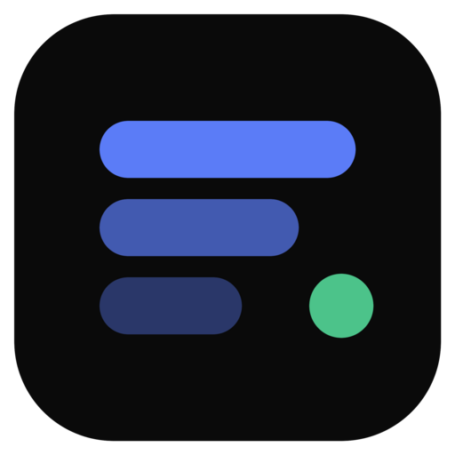
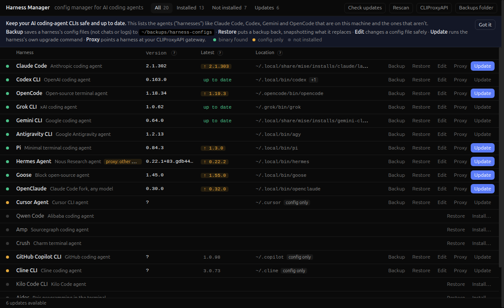

<p align="center">
  
</p>

<h1 align="center">Harness Manager</h1>

<p align="center">
  Back up, edit, restore and update the configs of your AI coding-agent CLIs, from one window.
</p>

<p align="center">
  <a href="https://github.com/dazeb/harness-manager/releases/latest"></a>
  <a href="LICENSE"></a>
  
</p>



Harness Manager is an Electron app that finds the AI coding agents on your machine (Claude Code, Codex, Gemini CLI, OpenCode and 16 more), shows which are installed, and lets you safely manage their configuration files.

## Features

- **Detect** — lists 20 coding-agent CLIs as installed, config-only or not installed, with their version and location.
- **Back up** — saves each harness's config files to `~/backups/harness-configs/<harness>/` as a `.tar.gz`. Only allowlisted config files are included; sessions, logs and caches are never captured.
- **Restore** — previews new, changed and unchanged files first, then snapshots anything it is about to overwrite.
- **Edit safely** — validates JSON, TOML and YAML before saving, keeps a `<file>.hm.bak`, and writes atomically.
- **Secrets stay secret** — credentials such as `auth.json` are excluded unless you opt in (the archive is then `chmod 600`), and they are never shown in the editor.
- **Update** — checks npm, PyPI, GitHub releases and each tool's own check command (cached for an hour). *Update* runs the harness's own upgrade command after you confirm it.
- **CLIProxyAPI** — point a harness at a [CLIProxyAPI](https://github.com/router-for-me/CLIProxyAPI) gateway with one click. Each change is previewed (the key is masked), snapshotted first, and can be disconnected to restore the original values.

## Supported harnesses

Claude Code · Codex CLI · OpenCode · Grok CLI · Gemini CLI · Antigravity CLI · Pi · Hermes Agent · Goose · OpenClaude · Cursor Agent · Qwen Code · Amp · Crush · GitHub Copilot CLI · Cline CLI · Kilo Code CLI · Aider · Kimi CLI · Droid

Adding a harness is one entry in [`lib/registry.js`](lib/registry.js).

## Install

1. Download `Harness-Manager-<version>-x86_64.AppImage` from the [latest release](https://github.com/dazeb/harness-manager/releases/latest).
2. Make it executable and run it:

   ```sh
   chmod +x Harness-Manager-*-x86_64.AppImage
   ./Harness-Manager-*-x86_64.AppImage
   ```

AppImages need FUSE. If it does not start, install it first:

- Ubuntu 24.04+ and Debian 13+: `sudo apt install libfuse2t64`
- Older releases: `sudo apt install libfuse2`

The AppImage launches Electron with `--no-sandbox`, because Ubuntu's AppArmor policy blocks the unprivileged user namespaces the Electron sandbox needs.

## Build from source

Requires Node.js and npm.

```sh
npm install
npm start          # run the app
npm test           # tests run against a throwaway $HOME and never touch your dotfiles
npm run dist       # builds dist/Harness-Manager-<version>-x86_64.AppImage
```

## Project layout

| Path | Purpose |
| --- | --- |
| `main.js` | Electron main process and IPC handlers |
| `preload.js` | Context-isolated bridge exposed to the UI as `window.hm` |
| `lib/core.js` | Detection, backups, restore, safe config editing, update checks |
| `lib/proxy.js` | CLIProxyAPI settings and per-harness connect / disconnect |
| `lib/registry.js` | Data-driven list of supported harnesses |
| `renderer/` | The UI (plain HTML, CSS and JavaScript) |
| `test/` | Unit tests, plus live checks in `test/live/` that run a real turn through the proxy |

## Privacy

Backups and the CLIProxyAPI settings live under your home directory and never leave your machine. Update checks query the npm and PyPI registries and GitHub's release pages (cached for an hour), and run when the app starts and when you press *Check updates*. Your CLIProxyAPI gateway is contacted only when you test or connect a harness to it.

## License

[MIT](LICENSE) © 2026 dazeb
